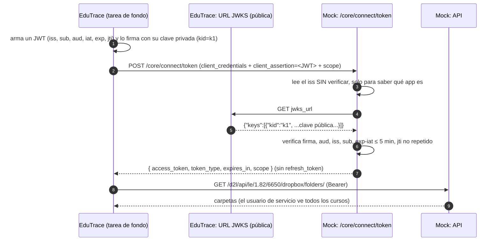

# 03 · OAuth 2.0: Client Credentials con aserción JWT (servidor a servidor)

Este flujo sirve cuando **no hay un usuario conectado**: por ejemplo, una tarea nocturna de
EduTrace que sincroniza las listas de clase o las carpetas de entrega de todos los cursos.

Archivos: `app/oauth/service.py` (`client_credentials`), `app/security/assertions.py`
(`verify_client_assertion`), `app/apps.py` (`register_client_credentials_app`).

---

## 1. La diferencia con Authorization Code

| | Authorization Code | Client Credentials |
|---|---|---|
| ¿Hay usuario? | Sí, inicia sesión y autoriza | No |
| ¿Como quién actúa el token? | Como el usuario que inició sesión | Como un **usuario de servicio** asociado a la app |
| ¿Cómo prueba la app quién es? | Con un **secreto compartido** (`client_secret`) | Con una **firma digital**: un JWT firmado con su **clave privada** |
| ¿Refresh token? | Sí (si está habilitado) | No: cuando vence, se pide otro token |
| ¿Páginas de login o consentimiento? | Sí | No |

### Por qué una firma y no un secreto

Con un secreto compartido, Brightspace y EduTrace conocen el mismo valor: si se filtra de
cualquiera de los dos lados, otro puede hacerse pasar por EduTrace. Con **criptografía de clave
pública**:

- EduTrace tiene una **clave privada** que nunca sale de su servidor.
- EduTrace publica la **clave pública** correspondiente en una URL (el **JWKS**).
- Brightspace verifica las firmas con la clave pública. Con ella **se puede verificar pero no
  firmar**, así que publicarla no es un riesgo.

## 2. Qué se registra

`admin.py register-s2s` → `register_client_credentials_app`. Se guarda en `oauth_clients`:

| Dato | Detalle |
|---|---|
| `client_id` | UUID aleatorio. No hay secreto |
| `jwks_url` | Dónde publica EduTrace sus claves públicas. Brightspace exige **HTTPS** [DOC]; el mock acepta también `http://` y `file://` mientras `ALLOW_INSECURE_JWKS=true` [MOCK] |
| `service_user_id` | El usuario de servicio con el que actúa el token. En la demo: `svc_edutrace` (rol de organización "Service User") [DOC: cada integración necesita su propio usuario de servicio] |
| `scopes`, `token_lifetime` | Igual que en la otra concesión |

El comando imprime el `aud` exacto que debe llevar la aserción: la URL del endpoint de token
(`AUTH_BASE_URL` + `/core/connect/token`).

## 3. El flujo



## 4. La petición de token

```http
POST /core/connect/token
Content-Type: application/x-www-form-urlencoded

grant_type=client_credentials
&client_assertion_type=urn:ietf:params:oauth:client-assertion-type:jwt-bearer
&client_assertion=eyJhbGciOiJSUzI1NiIsImtpZCI6ImsxIn0.eyJpc3MiOi...
&scope=enrollment:orgunit:read dropbox:folders:read
```

[DOC] Estos cuatro campos y sus valores salen tal cual de la documentación de OAuth 2.0 de D2L.

## 5. La aserción JWT: qué debe llevar

Un JWT tiene tres partes separadas por puntos: **encabezado . contenido (claims) . firma**, cada
una en base64url.

**Encabezado** [DOC]:

| Campo | Valor | Para qué |
|---|---|---|
| `alg` | `RS256`, `RS384`, `RS512`, `ES256`, `ES384` o `ES512` | El algoritmo de firma |
| `kid` | El identificador de la clave en tu JWKS | Para saber cuál de tus claves públicas usar (sirve cuando rotas claves) |

**Claims** [DOC]:

| Claim | Valor | Para qué |
|---|---|---|
| `iss` | Tu `client_id` | Quién emite la aserción |
| `sub` | Tu `client_id` (igual a `iss`) | En nombre de quién |
| `aud` | La URL **exacta** del endpoint de token | Que la aserción solo sirva para ese servidor: una aserción para otro servicio no se puede reusar aquí |
| `iat` | Momento de emisión (segundos Unix) | — |
| `exp` | Vencimiento. D2L recomienda ≤ 60 s; máximo 5 minutos | Que una aserción robada sirva poco tiempo |
| `jti` | Valor único (por ejemplo un UUID) | Que cada aserción se pueda usar **una sola vez** |

## 6. Lo que verifica el mock (`verify_client_assertion`)

En orden; cualquier fallo da **`401 invalid_client`** con la descripción del problema:

| # | Chequeo | Mensaje (`error_description`) |
|---|---|---|
| 1 | `client_assertion_type` es el valor exacto de jwt-bearer | `client_assertion_type debe ser ...` |
| 2 | La aserción es un JWT legible; se toma su `iss` **sin verificar** solo para encontrar la app | `client_assertion no es un JWT` |
| 3 | La app existe y es de tipo Client Credentials | `app desconocida o no es de tipo Client Credentials` |
| 4 | `alg` está en la lista permitida | `alg no permitido` |
| 5 | Hay `kid` | `falta 'kid' en el encabezado del JWT` |
| 6 | La URL JWKS se puede descargar (https; o http/file en modo inseguro), timeout 5 s | `no se pudo leer el JWKS del cliente` |
| 7 | El JWKS tiene una clave con ese `kid` | `el JWKS del cliente no tiene la clave kid=...` |
| 8 | Firma válida con esa clave y **ese** algoritmo; `aud` = endpoint de token; `iss` = client_id; están todos los claims; `exp` no vencido (con 30 s de tolerancia de reloj) | `aserción inválida: ...` |
| 9 | `sub` = client_id | `'sub' debe ser igual al client_id` |
| 10 | `exp - iat` ≤ 300 s | `la aserción vive más de 5 minutos` |
| 11 | El `jti` no se ha visto antes para esa app (tabla `oauth_used_jti`) | `el 'jti' ya se usó: cada aserción es de un solo uso` |

Después, el scope:

- Falta `scope` → `400 invalid_scope`.
- Algún scope no está registrado → `400 invalid_scope`.

Si todo pasa: un access token con `sub` = el **usuario de servicio**, `azp` = tu `client_id`, sin
refresh token.

### Detalles finos

- **Por qué se lee el `iss` sin verificar (paso 2)**: para verificar la firma hace falta saber qué
  app es (y así cuál JWKS descargar). Leer el `iss` sin verificar es seguro **porque después se
  verifica todo**, incluido que el `iss` sea ese `client_id` (paso 8). Si alguien miente en el
  `iss`, la firma no cuadra con el JWKS de esa app.
- **El algoritmo lo fija el servidor, no el token** (paso 8): el mock verifica con el algoritmo del
  encabezado solo si está en la lista permitida. Nunca acepta `none` ni HMAC (HS256), que es un
  ataque clásico.
- **El `jti` se recuerda** hasta que la aserción vence (+30 s); después se borra para que la tabla
  no crezca sin fin.
- **El JWKS se descarga en cada petición** [MOCK]: no hay caché. Si tu servidor JWKS está caído,
  cada solicitud de token falla. Brightspace probablemente cachea, pero no lo documenta.
- **El `aud` depende de `AUTH_BASE_URL`**: si el mock corre detrás de otra URL (IP del servidor,
  túnel HTTPS) y no actualizas `AUTH_BASE_URL`, todas las aserciones fallan por `aud`. Es a
  propósito: Brightspace también compara contra su URL exacta.

## 7. Qué tiene que construir EduTrace para usar este flujo

(Sin código, solo las piezas.)

1. **Un par de claves** (RSA de 2048 bits o EC P-256). La privada se guarda como secreto del
   servidor; nunca va al repositorio.
2. **Un endpoint público con el JWKS**: un JSON `{"keys": [ ... ]}` con la clave pública, su `kid`,
   `alg` y `use: "sig"`. Brightspace exige HTTPS.
3. **Una función que arme y firme la aserción** con los claims de la sección 5, con un `jti` nuevo
   y `exp` corto cada vez.
4. **La petición de token** de la sección 4, y guardar el access token hasta que venza; al vencer,
   pedir otro (no hay refresh).
5. **Rotación de claves** (más adelante): publicar la clave nueva en el JWKS con otro `kid`,
   empezar a firmar con ella y, después, retirar la vieja.

En las pruebas del mock (`tests/test_oauth.py`, fixture `s2s`) hay un ejemplo completo de estas
piezas, con el JWKS en un archivo local.

## 8. El usuario de servicio y los permisos

El token de este flujo actúa como `svc_edutrace`, cuyo rol de organización es "Service User". En el
mock, los usuarios de servicio y los administradores son **"staff" en todos los cursos**: ven
carpetas ocultas, todas las entregas y todas las notas [APROX: en Brightspace un administrador
asigna permisos concretos al usuario de servicio, idealmente los mínimos].

Lo que **no** puede hacer este token: entregar como estudiante (`mysubmissions`) ni ver "mis notas"
(`myGradeValue`), porque esas rutas exigen ser estudiante del curso.
