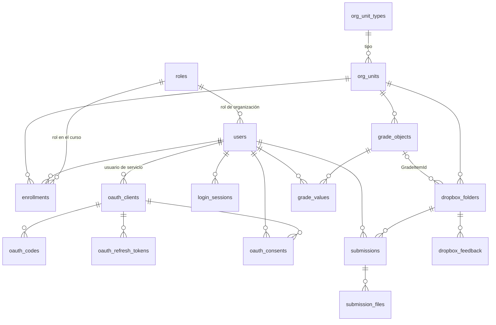

# 06 · Modelo de datos

Archivos: `app/db.py` (esquema y conexión), `app/seed.py` (datos de demostración),
`app/api/formats.py` (conversión a JSON de D2L).

---

## 1. Dos modelos distintos: tablas vs JSON de D2L

El mock **no** guarda los datos con la forma del JSON de Brightspace. Guarda tablas normalizadas, y
`formats.py` arma el JSON de D2L al responder. Ejemplo: la tabla `dropbox_folders` tiene
`start_date` y `end_date` sueltos; `formats.dropbox_folder` los mete en el objeto `Availability`, y
si ambos son `null`, `Availability` sale `null`.

Por qué: las tablas se diseñaron para consultar y validar fácil; el JSON, para ser idéntico a D2L.
Separarlos permite cambiar uno sin tocar el otro. Es lo mismo que hiciste en Spring Boot con
entidades y DTOs.

## 2. Diagrama entidad-relación

## 3. Las tablas

### Estructura académica

| Tabla | Columnas clave | Notas |
|---|---|---|
| `org_unit_types` | `id`, `code`, `name` | 1 = Organization, 3 = Course Offering [APROX] |
| `org_units` | `id`, `type_id`, `name`, `code`, `is_active`, `start_date`, `end_date` | La organización y los cursos. En Brightspace todo es una "unidad organizacional" (org unit): la universidad, facultades, cursos… |
| `roles` | `id`, `code`, `name`, `kind` | `kind` ∈ `instructor`, `student`, `admin`, `service`, `user`. El mock decide permisos por `kind` |
| `users` | `id`, `username` (único), `first_name`, `last_name`, `email`, `org_defined_id`, `profile_identifier`, `password_hash`, `is_active`, `org_role_id`, `created_at`, `last_accessed` | `password_hash` es `NULL` en usuarios de servicio (no inician sesión). `last_accessed` nunca se actualiza [MOCK] |
| `enrollments` | (`user_id`, `org_unit_id`) PK, `role_id` | La inscripción con su rol en ese curso |

### OAuth

| Tabla | Columnas clave | Notas |
|---|---|---|
| `oauth_clients` | `client_id` PK, `name`, `grant_type`, `secret_hash`, `redirect_uri`, `jwks_url`, `service_user_id`, `scopes`, `token_lifetime`, `refresh_enabled`, `prompt_consent` | Las apps registradas. `secret_hash`/`redirect_uri` solo en Authorization Code; `jwks_url`/`service_user_id` solo en Client Credentials |
| `oauth_consents` | (`user_id`, `client_id`) PK | Usuarios que ya autorizaron una app |
| `oauth_codes` | `code_hash` PK, `client_id`, `user_id`, `redirect_uri`, `scope`, `expires_at`, `used` | Códigos de autorización (5 min, un uso) |
| `oauth_refresh_tokens` | `token_hash` PK, `client_id`, `user_id`, `scope`, `expires_at`, `used` | Refresh tokens (un uso) |
| `oauth_used_jti` | (`client_id`, `jti`) PK, `expires_at` | `jti` ya vistos en aserciones JWT |
| `login_sessions` | `session_hash` PK, `user_id`, `csrf_token`, `expires_at` | Sesiones del navegador en la página de login del mock |

Todo lo que es credencial (códigos, refresh tokens, sesiones) se guarda como **SHA-256**; los
secretos de app y las contraseñas, con **PBKDF2** (ver sección 6). Los access tokens **no se
guardan**: son JWT que se verifican con la firma.

### Tareas, entregas y notas

| Tabla | Columnas clave | Notas |
|---|---|---|
| `grade_objects` | `id`, `org_unit_id`, `name`, `short_name`, `max_points`, `can_exceed`, `is_bonus`, `exclude_from_final`, `description`, `is_hidden` | Ítems del libro de calificaciones (columnas). Solo numéricos |
| `dropbox_folders` | `id`, `org_unit_id`, `name`, `instructions_text`, `instructions_html`, `start_date`, `end_date`, `due_date`, `is_hidden`, `score_denominator`, `dropbox_type`, `submission_type`, `completion_type`, `submission_rule`, `grade_item_id`, … | Carpetas de entrega. `grade_item_id` → `grade_objects` |
| `submissions` | `id`, `folder_id`, `user_id`, `submitted_at`, `comment_text`, `comment_html` | Cada vez que un estudiante entrega |
| `submission_files` | `id`, `submission_id`, `file_name`, `content_type`, `size`, `storage_path`, `is_read`, `is_flagged` | Archivos de cada entrega; el contenido está en disco |
| `dropbox_feedback` | (`folder_id`, `entity_type`, `entity_id`) PK, `score`, `feedback_text`, `feedback_html`, `is_graded`, `updated_at` | Una retroalimentación por estudiante y carpeta (no por entrega) |
| `grade_values` | (`grade_object_id`, `user_id`) PK, `points`, `comments_*`, `private_*`, `last_modified`, `last_modified_by`, `released_date` | La nota de un estudiante en un ítem |

### Borrados en cascada

Las llaves foráneas tienen `ON DELETE CASCADE` (o `SET NULL` en `grade_item_id`): borrar una app
borra sus códigos, refresh tokens y consentimientos; borrar un curso borra carpetas, entregas, etc.
Las llaves foráneas se activan en cada conexión (`PRAGMA foreign_keys = ON`).

## 4. Fechas

- Se guardan como **texto** en el formato de D2L: `yyyy-MM-ddTHH:mm:ss.fffZ` (UTC).
- `to_d2l_date` convierte de Python a ese texto; `parse_d2l_date` hace lo contrario y **rechaza
  cualquier otro formato** (por ejemplo `2026-11-30`, o con 6 decimales, o sin `Z`).
- Las expiraciones de OAuth (`expires_at`) se guardan como números (segundos Unix), porque solo
  se comparan, nunca se envían.

## 5. Archivos en disco

Las entregas se guardan en `data/uploads/<id_entrega>/<id_archivo>`. El nombre original del
archivo solo vive en la base (`file_name`), limpiado para quitar rutas (`../../`), así que un
nombre malicioso no puede escribir fuera de la carpeta.

[MOCK] Con la regla `OverwriteSubmissions`, las entregas anteriores se borran de la base, pero sus
archivos quedan huérfanos en disco.

## 6. Contraseñas y secretos

`app/security/passwords.py`:

- **PBKDF2-HMAC-SHA256**, 200.000 iteraciones, sal aleatoria de 16 bytes.
- Formato guardado: `pbkdf2_sha256$200000$<sal base64>$<hash base64>`.
- Verificación en tiempo constante (`hmac.compare_digest`).
- Se usa para las contraseñas de usuarios **y** para los `client_secret` de las apps.

## 7. Datos de demostración (`app/seed.py`)

Se cargan **solo si la tabla `users` está vacía** (primer arranque o después de `admin.py reset`).

### Organización y cursos

| ID | Tipo | Nombre | Código |
|---|---|---|---|
| 6606 | Organization | Universidad Simulada | UNI |
| 6650 | Course Offering | Introducción a la Programación (2026-2) | IP-2026-2 |
| 6651 | Course Offering | Estructuras de Datos (2026-2) | ED-2026-2 |

Los cursos empiezan 60 días antes y terminan 60 días después **del momento en que se cargaron los
datos**.

### Usuarios (contraseña `Mock2026!`, o la de `MOCK_DEMO_PASSWORD`)

| ID | Usuario | Nombre | Rol de organización | Inscripción |
|---|---|---|---|---|
| 3001 | `docente1` | Ana Rojas | User | Instructor en 6650 |
| 3002 | `docente2` | Luis Pardo | User | Instructor en 6651 |
| 3101 | `estudiante1` | Camila Díaz | User | Student en 6650 |
| 3102 | `estudiante2` | Mateo Gómez | User | Student en 6650 |
| 3103 | `estudiante3` | Valentina Ruiz | User | Student en 6650 |
| 3104 | `estudiante4` | Samuel Torres | User | Student en 6651 |
| 3900 | `admin` | Admin Mock | Administrator | (ve todos los cursos) |
| 3950 | `svc_edutrace` | Servicio EduTrace | Service User, sin contraseña | (ve todos los cursos) |

### Ítems de calificación

| ID | Curso | Nombre | Máximo |
|---|---|---|---|
| 5001 | 6650 | Taller 1: Condicionales | 5 |
| 5002 | 6650 | Taller 2: Ciclos | 5 |
| 5101 | 6651 | Taller 1: Listas enlazadas | 5 |

### Carpetas de entrega

Fechas relativas al momento de cargar los datos (H = ese momento):

| ID | Curso | Nombre | Abre | Fecha límite | Cierra | Oculta | Denominador | Ítem de nota |
|---|---|---|---|---|---|---|---|---|
| 701 | 6650 | Taller 1: Condicionales | H − 7 d | H + 14 d | H + 21 d | no | 100 | 5001 |
| 702 | 6650 | Taller 2: Ciclos | H − 7 d | H + 14 d | H + 21 d | no | 100 | 5002 |
| 703 | 6650 | Taller 3 (borrador oculto) | H − 7 d | H + 14 d | H + 21 d | **sí** | 100 | — |
| 704 | 6650 | Taller 0 (cerrado) | H − 30 d | H − 20 d | H − 15 d | no | 100 | — |
| 751 | 6651 | Taller 1: Listas enlazadas | H − 7 d | H + 14 d | H + 21 d | no | 100 | 5101 |

Y una entrega de ejemplo de `estudiante1` en la 701 con un `main.cpp`.

> **Ojo con las fechas relativas.** Las carpetas 701, 702 y 751 **se cierran 21 días después** de
> cargar los datos. Pasado ese plazo, entregar responde 403 ("not authorized to submit … at this
> time"). Para renovar las fechas: `python admin.py reset` (borra **todo**, incluidas las apps
> registradas y la clave de firma) o crear carpetas nuevas con `POST .../dropbox/folders/`.
> Los cursos se desactivan a los 60 días por el mismo motivo.

### Por qué estos datos

Cada uno existe para probar un caso:

| Dato | Caso que permite probar |
|---|---|
| Dos cursos con docentes distintos | Que un docente no pueda tocar el curso de otro (403) |
| Carpeta oculta (703) | Que el estudiante no la vea (404) y el docente sí |
| Carpeta cerrada (704) | Que no se pueda entregar fuera de la ventana (403) |
| Carpetas enlazadas a ítems de nota | Que publicar retroalimentación pase la nota al libro |
| Entrega de ejemplo | Que el docente vea algo al listar entregas sin tener que entregar antes |
| `admin` y `svc_edutrace` | Usuarios con acceso a todo, para el flujo servidor a servidor |
| Usuario de servicio sin contraseña | Que nadie pueda iniciar sesión como él en la página de login |

## 8. Cómo se convierten los datos en JSON (`formats.py`)

| Función | Estructura de D2L | De qué tablas |
|---|---|---|
| `who_am_i` | `User.WhoAmIUser` | `users` |
| `user_data` | `User.UserData` | `users` + id de la organización |
| `user_composite` | `User.User` | `users` |
| `my_org_unit_info` | `Enrollment.MyOrgUnitInfo` | `enrollments` + `org_units` + `org_unit_types` + `roles` |
| `classlist_user` | `Enrollment.ClasslistUser` | `enrollments` + `users` + `roles` |
| `paged_result_set` / `object_list_page` | `Api.PagedResultSet` / `Api.ObjectListPage` | — |
| `dropbox_folder` | `Dropbox.DropboxFolder` | `dropbox_folders` + conteos |
| `entity_dropbox` + `submission` | `Dropbox.EntityDropbox` | `submissions` + `submission_files` + `dropbox_feedback` |
| `feedback_out` | `Dropbox.DropboxFeedbackOut` | `dropbox_feedback` |
| `grade_object` | `Grade.GradeObject` | `grade_objects` + carpeta enlazada |
| `grade_value` / `final_grade_value` | `Grade.GradeValue` | `grade_values` + `grade_objects` |
| `rich_text` / `read_rich_text_input` | `RichText` / `RichTextInput` | columnas `*_text` y `*_html` |

### `RichText` vs `RichTextInput` [DOC]

- **Salida** (`RichText`): `{"Text": "...", "Html": "..." | null}`.
- **Entrada** (`RichTextInput`): `{"Content": "...", "Type": "Text" | "Html"}`.

El mock acepta también `RichText` como entrada, por tolerancia. Con `Type: "Html"` guarda el HTML y
genera el texto quitando las etiquetas; con `Type: "Text"`, `Html` queda `null`.
