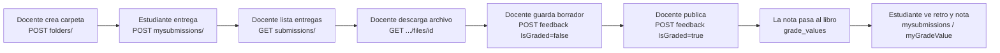

# 07 · Entregas, retroalimentación y notas

El ciclo de vida de una tarea en el mock, de principio a fin, con las reglas exactas y los casos
borde. Archivos: `app/api/dropbox.py`, `app/api/grades.py`, `app/api/common.py`.

---

## 1. El ciclo completo



Fíjate en el paso E → F: **borrador primero, publicación después**. Encaja con la idea de EduTrace
de que el docente revise la retroalimentación antes de que llegue al estudiante.

---

## 2. Entregar: el formato `multipart/mixed`

### Qué es

Una petición HTTP normal lleva **un** cuerpo. `multipart` permite mandar **varias partes** en una
sola petición, separadas por una cadena (el *boundary*). Brightspace usa `multipart/mixed`
(RFC 2046) para las entregas [DOC]: la primera parte es JSON con el comentario y las siguientes son
los archivos.

No confundir con `multipart/form-data`, que es lo que usan los formularios HTML: comparten la idea,
pero el tipo de contenido es otro. Postman y la mayoría de clientes HTTP arman `form-data` solos;
`mixed` hay que armarlo a mano.

### Anatomía de la petición

```http
POST /d2l/api/le/1.82/6650/dropbox/folders/702/submissions/mysubmissions/ HTTP/1.1
Authorization: Bearer eyJ...
Content-Type: multipart/mixed; boundary=xxBOUNDARYxx

--xxBOUNDARYxx
Content-Type: application/json

{"Text": "versión final", "Html": null}
--xxBOUNDARYxx
Content-Disposition: form-data; name=""; filename="main.cpp"
Content-Type: text/x-c++src

#include <iostream>
int main() { ... }
--xxBOUNDARYxx--
```

Línea por línea:

| Parte | Qué es | Regla del mock |
|---|---|---|
| `Content-Type: multipart/mixed; boundary=...` | Encabezado de la petición | Si no es `multipart/mixed`: 415. Si falta `boundary`: 400 |
| `--xxBOUNDARYxx` | Inicio de cada parte: dos guiones + el boundary | El boundary no puede aparecer dentro de los datos |
| Primera parte, `application/json` | El comentario, como `RichText` (`{"Text","Html"}`) o `RichTextInput` (`{"Content","Type"}`); puede ser `null` | Si la primera parte no es JSON: 400. JSON inválido: 400. Mayor a 1 MB: 413 |
| Partes siguientes | Un archivo cada una | Cada una necesita `Content-Disposition` con `filename`; si no: 400 |
| `name=""` | [DOC] D2L dice que el nombre debe ir vacío | El mock no lo exige (tolerante) |
| `Content-Type` del archivo | Tipo MIME del archivo | Se guarda y se devuelve al descargar |
| `--xxBOUNDARYxx--` | Fin (con dos guiones al final) | — |

Cada línea termina en `\r\n` (CRLF), como en todo HTTP.

**Al menos un archivo es obligatorio** [DOC]. Se permiten varios archivos en la misma entrega.

### Cómo lo lee el mock (`_parse_multipart_mixed`)

1. Pega el encabezado `Content-Type` al cuerpo y se lo da al parser de correos de Python
   (`email.parser`), que entiende MIME (el mismo formato de los correos con adjuntos).
2. Revisa que sea multipart y que tenga partes.
3. Lee la primera parte como JSON → comentario.
4. Lee el resto como archivos (nombre, tipo, bytes).

### Reglas antes de aceptar la entrega (`submit`)

En este orden:

| # | Regla | Error |
|---|---|---|
| 1 | Token con `dropbox:folders:write` | 403 |
| 2 | Quien llama es **estudiante** del curso (ni docentes ni servicio) | 403 |
| 3 | La carpeta existe y no está oculta | 404 |
| 4 | **La carpeta está abierta**: ahora ≥ `StartDate` y ahora ≤ `EndDate` (si existen) | 403 |
| 5 | La carpeta acepta archivos: `SubmissionType` 0 (archivo) o 4 (archivo o texto) | 405 |
| 6 | `Content-Type` es `multipart/mixed` | 415 |
| 7 | Tamaño total ≤ `MAX_UPLOAD_BYTES` (50 MB por defecto; D2L ~490 MB) | 413 |
| 8 | Cuerpo bien formado, con al menos un archivo | 400 |
| 9 | Regla de entregas de la carpeta (abajo) | 403 |

### Fecha límite vs ventana de disponibilidad

- **`DueDate`** es la fecha límite que ve el estudiante. **El mock no la hace cumplir**: se puede
  entregar tarde.
- **`Availability.EndDate`** es cuando la carpeta se **cierra**. Después de eso, 403.

En Brightspace es igual: la entrega después de `DueDate` queda marcada como tardía, y el cierre lo
da la disponibilidad [APROX: el mock no marca "tardía"].

### Regla de entregas (`SubmissionRule`) [APROX]

| Valor | Comportamiento |
|---|---|
| `AllSubmissions` (por defecto) | Se guardan todas las entregas; cada una es un elemento de `Submissions` |
| `OnlyOneSubmission` | Si el estudiante ya entregó en esa carpeta: 403 |
| `OverwriteSubmissions` | La entrega nueva borra las anteriores del estudiante en esa carpeta |

### Respuesta

**200 sin cuerpo** [DOC]. No devuelve el ID de la entrega: para conocerlo, consulta
`GET .../submissions/mysubmissions/` y toma la última de `Submissions`.

---

## 3. Ver entregas

| Quién | Ruta | Qué ve |
|---|---|---|
| Docente / servicio | `GET .../submissions/` o `.../submissions/paged/` | Un `EntityDropbox` por **cada estudiante activo**, haya entregado o no |
| Docente / servicio | `GET .../submissions/user/(userId)` | El de un estudiante |
| Estudiante | `GET .../submissions/mysubmissions/` | El propio |

### El `Status` de cada estudiante [DOC: valores; APROX: cálculo]

| Status | Nombre | Cuándo |
|---|---|---|
| 0 | Unsubmitted | No tiene entregas y no tiene retroalimentación visible para quien mira |
| 1 | Submitted | Tiene entregas y no tiene retroalimentación visible para quien mira |
| 2 | Draft | Tiene retroalimentación **en borrador** y quien mira es docente/servicio |
| 3 | Published | Tiene retroalimentación **publicada** (`IsGraded: true`) |

`Feedback` dentro del `EntityDropbox` va `null` salvo en Draft (solo para el docente) y Published.

Notar que la retroalimentación es **por estudiante y carpeta**, no por entrega: si un estudiante
entrega tres veces, hay una sola retroalimentación para las tres.

### Descargar archivos

`GET .../submissions/(submissionId)/files/(fileId)`: el docente descarga cualquiera; el estudiante
solo los suyos (los de otro → 404). Se responde con el tipo de contenido original y como descarga.

---

## 4. Retroalimentación: borrador y publicación

`POST .../feedback/user/(userId)` con `DropboxFeedback`:

```json
{ "Score": 80, "Feedback": { "Text": "Buen manejo de condicionales.", "Html": null }, "IsGraded": false }
```

| `IsGraded` | Efecto |
|---|---|
| `false` (o ausente) | **Borrador**: el docente la ve; el estudiante no (404 en `GET feedback`, sin `Feedback` en `mysubmissions`) |
| `true` | **Publicada**: el estudiante la ve; el `Status` pasa a 3; si la carpeta tiene ítem de nota, **la nota se copia al libro** |

Puntos importantes:

- **Cada POST reemplaza todo.** No es una edición parcial: si el segundo POST no trae `Feedback`,
  el texto queda vacío; si trae `Score: null`, se borra el puntaje.
- **No se puede retroalimentar a quien no es estudiante del curso** (404). Tampoco a grupos.
- **No hace falta que el estudiante haya entregado** para recibir retroalimentación.
- [DOC] D2L advierte no volver `IsGraded` a `false` después de haberlo puesto en `true`. El mock lo
  permite, pero **no** borra la nota que ya pasó al libro.

---

## 5. Cómo pasa la nota al libro de calificaciones [APROX]

Cuando se publica (`IsGraded: true`), con `Score` no nulo, en una carpeta con `GradeItemId`:

```
puntos = Score ÷ denominador × MaxPoints del ítem
```

donde `denominador` es el `ScoreDenominator` de la carpeta, o, si no tiene, el `MaxPoints` del ítem.
Se redondea a 4 decimales.

Ejemplo con los datos de demo: carpeta 701 (denominador 100) enlazada al ítem 5001 (máximo 5).
`Score: 80` → `80 ÷ 100 × 5 = 4.0` puntos.

Además:

- El texto de la retroalimentación se copia a los `Comments` de la nota.
- La nota queda publicada de inmediato (`ReleasedDate` = ahora) y `LastModifiedBy` = quien publicó.
- El `Score` **no** se limita al denominador: `Score: 120` sobre 100 da 6 puntos sobre 5.
- Si la carpeta no tiene `GradeItemId`, o el `Score` es `null`, no se toca el libro.

Por qué [APROX]: así funciona la interfaz web de Brightspace cuando una carpeta está asociada a un
ítem de calificación. La documentación de la API no dice si ocurre igual al publicar por API, así
que **verifícalo contra Brightspace real** antes de depender de ello. La alternativa segura es
escribir la nota explícitamente con `PUT .../grades/(gradeObjectId)/values/(userId)`.

---

## 6. Poner notas directamente

`PUT .../grades/(gradeObjectId)/values/(userId)` con `IncomingGradeValue` (ver
`05-REFERENCIA-API.md`). Diferencias con la vía de la retroalimentación:

| | Vía retroalimentación | Vía `PUT` de nota |
|---|---|---|
| Unidad | `Score` sobre el denominador de la carpeta | Puntos sobre `MaxPoints` del ítem |
| Límite | Ninguno | ≤ `MaxPoints` salvo `CanExceedMaxPoints` |
| Comentarios | Copia el texto de la retroalimentación | `Comments` y `PrivateComments` propios; si no vienen, conserva los anteriores |
| Requiere carpeta | Sí, enlazada a un ítem | No |

Ambas sobrescriben la nota anterior del estudiante en ese ítem.

> Recordatorio: en el contrato de API que armamos para EduTrace, siguiendo el requisito RF-17,
> EduTrace no maneja notas. Estas rutas existen en el mock porque son parte de Brightspace; que
> EduTrace las use es una decisión del equipo.

---

## 7. Lo que ve el estudiante

| Ruta | Muestra |
|---|---|
| `GET .../submissions/mysubmissions/` | Sus entregas; la retroalimentación solo si está publicada |
| `GET .../feedback/user/(su id)` | Su retroalimentación publicada (borrador → 404) |
| `GET .../grades/(id)/values/myGradeValue` | Su nota en un ítem (sin comentarios privados) |
| `GET .../grades/values/myGradeValues/` | Todas sus notas publicadas del curso |
| `GET .../grades/final/values/myGradeValue` | Nota final calculada: puntos obtenidos ÷ máximos de los ítems con nota (sin ocultos, bonus ni excluidos) |

---

## 8. Qué falta en este ciclo (fuera del MVP)

- Entregas grupales (`DropboxType: 1`) y entidades `group`.
- Entregas de solo texto (sin archivo).
- Archivos adjuntos en la retroalimentación (carga resumible: `/feedback/.../upload` y `/attach`).
- Rúbricas (`RubricAssessments`) y `GradedSymbol`.
- Marcar archivos como leídos (`markAsRead`) o con bandera.
- Adjuntos en las carpetas (`Attachments`, `LinkAttachments`).
- Crear o editar ítems de calificación por API.
- Marcar entregas como tardías.
