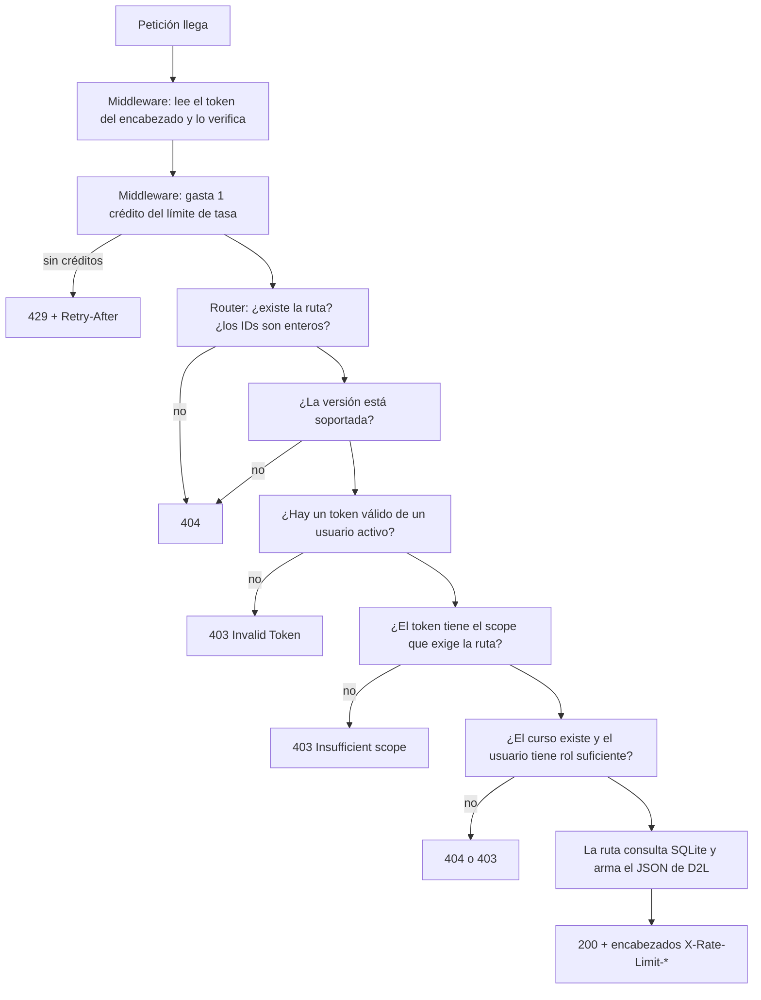
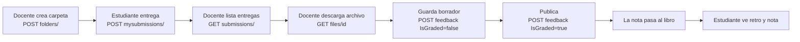

# Mock de Brightspace — Especificación y flujos de uso

Este documento hace tres cosas:

1. **Explica de forma general cómo funciona el mock** (sección 1).
2. **Explica, paso a paso, cómo usar cada funcionalidad que ofrece** (sección 2, "Flujos de uso").
3. **Dice qué copia el mock de Brightspace real y qué aproxima** (secciones 3 a 9).

Todo lo marcado como **[DOC]** sale de la documentación oficial de D2L (consultada el 21-oct-2026).
Lo marcado como **[APROX]** no está documentado públicamente o la documentación es ambigua: el mock
elige un comportamiento razonable y lo deja configurable cuando se puede. Lo marcado como **[MOCK]**
solo existe en el mock.

Regla para EduTrace: **si el cliente funciona contra el mock en modo estricto, debería funcionar
contra Brightspace real**. Lo contrario no está garantizado en los puntos [APROX].

Cada explicación termina con una línea **Fuente** que indica el documento de esta carpeta del que se
tomó, por si quieres profundizar. El índice completo está en [`00-INDICE.md`](00-INDICE.md); los
términos desconocidos, en [`10-GLOSARIO.md`](10-GLOSARIO.md).

---

## 1. Cómo funciona el mock (visión general)

### 1.1 Un proceso, dos papeles

El mock es **un solo proceso Python** (FastAPI servido por uvicorn) que hace dos papeles que en
Brightspace real son dos sistemas distintos:

| Papel | Qué hace | En Brightspace real | En el mock |
|---|---|---|---|
| **Servidor de autorización** | Login, consentimiento y emisión de tokens | `https://auth.brightspace.com` | `/oauth2/auth` y `/core/connect/token` |
| **Servidor de recursos** | La API con los datos de cursos, tareas y notas | `https://<universidad>.brightspace.com` | `/d2l/api/...` |

Por eso hay dos variables de configuración, `AUTH_BASE_URL` y `API_BASE_URL`, aunque apunten al mismo
proceso.

> **Fuente:** [`01-ARQUITECTURA.md`](01-ARQUITECTURA.md) §1.

### 1.2 De qué está hecho

| Pieza | Para qué |
|---|---|
| **FastAPI** | El framework web. Valida parámetros y genera documentación interactiva en `/.mock/docs` |
| **SQLite** | Una base de datos en un solo archivo, sin servidor que mantener |
| **PyJWT + cryptography** | Firmar y verificar los tokens JWT con RSA |
| **httpx** | Descargar el JWKS de una app en el flujo servidor a servidor |
| **python-multipart** | Leer los formularios HTML de login y consentimiento |

El código se organiza en tres bloques: `app/oauth/` (el servidor de autorización),
`app/security/` (contraseñas, claves, tokens, scopes, límite de tasa) y `app/api/` (un archivo por
grupo de rutas de D2L: usuarios, inscripciones, carpetas de entrega, notas). Consume unos 60 MB de RAM.

> **Fuente:** [`01-ARQUITECTURA.md`](01-ARQUITECTURA.md) §2-3.

### 1.3 El viaje de una petición

Cuando EduTrace llama a, por ejemplo, `GET /d2l/api/le/1.82/6650/dropbox/folders/` con un token, la
petición pasa por estas etapas, **en este orden**:



Cosas que explican errores que verás:

- **El orden de los chequeos determina qué error ves.** Un estudiante sin scope que pide un curso
  inexistente ve el 403 de scope, no el 404 del curso, porque el scope se revisa antes.
- **El límite de tasa se aplica antes de saber si el token es bueno.** Una petición con token
  inválido igual gasta un crédito (de la cubeta de la IP).
- **El token se lee en el middleware, pero se exige después.** Por eso las rutas de versiones (sin
  token) funcionan y las demás fallan con `403 Invalid Token`.
- **Una transacción por petición:** si algo falla a mitad de camino, nada de lo que alcanzó a
  escribirse queda guardado.

> **Fuente:** [`01-ARQUITECTURA.md`](01-ARQUITECTURA.md) §5 (el viaje de una petición y el orden de
> los chequeos).

### 1.4 Qué decide si una llamada pasa

Cuatro capas, cada una con su error:

| Capa | Pregunta | Si falla |
|---|---|---|
| Token | ¿Es válido, vigente, y de un usuario activo? | `403 Invalid Token` (no 401) |
| Scope | ¿Tiene el permiso que exige la ruta (`grupo:recurso:acción`)? | `403 Insufficient scope` |
| Rol | ¿Es docente, estudiante o staff **en ese curso**? | `403` (o `404` si el recurso "no existe" para él) |
| Límite de tasa | ¿La app tiene créditos en su cubeta? | `429` + `Retry-After` |

El scope dice **qué tipo de operación** puede hacer la app; el rol dice **sobre qué cursos** puede
hacerla el usuario. Se necesitan ambos. Para no revelar que algo existe, algunas negativas son 404
(por ejemplo, un estudiante que pide una carpeta oculta).

> **Fuente:** [`04-TOKENS-SCOPES-PERMISOS.md`](04-TOKENS-SCOPES-PERMISOS.md) (introducción, §2, §3 y §5).

### 1.5 Dónde guarda los datos

- Una base **SQLite** con tablas normalizadas (`data/brightspace_mock.sqlite3`). Cuando responde, el
  módulo `formats.py` arma el **JSON con la forma exacta de D2L**. Es la misma idea de entidades y DTOs:
  las tablas se diseñaron para consultar y validar fácil; el JSON, para ser idéntico a D2L.
- Los archivos entregados van a disco en `data/uploads/`.
- La clave con la que se firman los tokens vive en `data/signing_key.pem`.
- De los códigos, refresh tokens y sesiones solo se guarda el **hash**; de las contraseñas y secretos,
  un hash **PBKDF2**. Los access tokens no se guardan: se verifican con su firma.
- Al arrancar por primera vez se cargan los [datos de demostración](06-MODELO-DE-DATOS.md) (usuarios,
  dos cursos, carpetas de entrega y una entrega de ejemplo).

> **Fuente:** [`06-MODELO-DE-DATOS.md`](06-MODELO-DE-DATOS.md) §1, §3, §5-7;
> [`01-ARQUITECTURA.md`](01-ARQUITECTURA.md) §6.

### 1.6 Principio de diseño: ser más estricto que Brightspace

Donde D2L es ambiguo, el mock elige el comportamiento **más estricto**, para que un cliente que
funciona aquí no se rompa allá. Ejemplos: la barra final de las rutas es obligatoria (`/folders/` y
`/folders` son rutas distintas), `redirect_uri` debe coincidir exactamente, el scope es obligatorio al
pedir autorización, y `core:*:*` no abre ninguna ruta por defecto.

> **Fuente:** [`00-INDICE.md`](00-INDICE.md) ("La idea en un párrafo");
> [`01-ARQUITECTURA.md`](01-ARQUITECTURA.md) §7 (decisiones de diseño);
> [`04-TOKENS-SCOPES-PERMISOS.md`](04-TOKENS-SCOPES-PERMISOS.md) §2 (el caso `core:*:*`).

---

## 2. Flujos de uso

Cada flujo describe: **quién** lo hace, **qué necesita** (scope y rol), **los pasos** con las
peticiones, **qué responde** el mock y **qué errores** pueden salir. Los valores de los ejemplos (IDs,
fechas, tokens) son ilustrativos. En todas las rutas, la barra final se escribe **exactamente** como
aparece aquí.

### Mapa de los flujos

| Flujo | Para qué sirve | Quién |
|---|---|---|
| [2.0](#20-preparación-registrar-la-aplicación) | Registrar EduTrace en el mock | Administrador |
| [2.1](#21-descubrir-las-versiones-de-la-api) | Elegir una versión soportada | Cualquiera |
| [2.2](#22-iniciar-sesión-de-un-usuario-authorization-code) | "Entrar con Brightspace" | Docente o estudiante |
| [2.3](#23-mantener-la-sesión-refresh-token) | Renovar el token sin volver a loguear | EduTrace (backend) |
| [2.4](#24-trabajar-sin-usuario-client-credentials) | Tareas de fondo | EduTrace (backend) |
| [2.5](#25-descubrir-cursos-roles-y-lista-de-clase) | Saber en qué cursos está cada persona y con qué rol | Cualquiera |
| [2.6](#26-crear-y-consultar-carpetas-de-entrega) | Gestionar las tareas | Docente |
| [2.7](#27-entregar-una-tarea) | Subir archivos | Estudiante |
| [2.8](#28-revisar-entregas-y-descargar-archivos) | Ver quién entregó qué | Docente |
| [2.9](#29-retroalimentar-borrador-publicación-y-nota) | Borrador → publicar → nota en el libro | Docente |
| [2.10](#210-poner-y-consultar-notas-directamente) | Notas sin pasar por la retroalimentación | Docente / estudiante |
| [2.11](#211-lo-que-ve-el-estudiante) | Ver lo propio | Estudiante |
| [2.12](#212-errores-límite-de-tasa-y-paginación-en-cualquier-flujo) | Cómo reaccionar a 403, 404, 429 y listas largas | EduTrace (backend) |

### 2.0 Preparación: registrar la aplicación

**Quién:** el administrador (en Brightspace real, desde *Manage Extensibility > OAuth 2.0*; en el mock,
con `admin.py`).

1. Registrar EduTrace con el tipo de concesión que necesite:

   ```bash
   # Usuarios que inician sesión
   python admin.py register-app --name EduTrace \
     --redirect-uri http://localhost:8000/auth/brightspace/callback \
     --scopes "users:own_profile:read enrollment:own_enrollment:read dropbox:folders:read,write"

   # Tareas de fondo sin usuario
   python admin.py register-s2s --name "EduTrace sync" \
     --jwks-url http://localhost:8000/.well-known/jwks.json \
     --scopes "enrollment:orgunit:read dropbox:folders:read" --service-user svc_edutrace
   ```

2. Guardar lo que imprime: el `client_id` y, en la primera, el `client_secret` (**solo se muestra una
   vez**). En la segunda, el `aud` exacto que deben llevar las aserciones.
3. Configurar en EduTrace las dos URL (`AUTH_BASE_URL` y `API_BASE_URL`), el `client_id` y el secreto
   (en variables de entorno, nunca en el repositorio ni en el frontend).

**Errores típicos:** una `redirect_uri` que no empiece por `http://` o `https://` o un `--lifetime`
fuera de 1800–72000 se rechazan al registrar.

> **Fuente:** [`02-OAUTH-AUTHORIZATION-CODE.md`](02-OAUTH-AUTHORIZATION-CODE.md) §2;
> [`03-OAUTH-CLIENT-CREDENTIALS.md`](03-OAUTH-CLIENT-CREDENTIALS.md) §2;
> [`08-OPERACION-Y-PRUEBAS.md`](08-OPERACION-Y-PRUEBAS.md) §3 (tabla de `admin.py`).

### 2.1 Descubrir las versiones de la API

**Quién:** cualquiera. **Necesita:** nada (rutas anónimas [DOC]).

Cada ruta lleva producto y versión (`/d2l/api/lp/1.49/...`, `/d2l/api/le/1.82/...`). En vez de fijar la
versión en el código, EduTrace puede preguntarla al arrancar:

```http
GET /d2l/api/versions/
```

```json
[
  { "ProductCode": "lp", "LatestVersion": "1.49", "SupportedVersions": ["1.46", "1.47", "1.48", "1.49"] },
  { "ProductCode": "le", "LatestVersion": "1.82", "SupportedVersions": ["1.79", "1.80", "1.81", "1.82"] }
]
```

Otras rutas: `GET /d2l/api/(lp|le)/versions/`, `GET /d2l/api/(lp|le)/versions/(version)` y
`POST /d2l/api/versions/check` (valida varias versiones de una vez).

**Errores:** una versión no soportada en cualquier otra ruta da 404 (`Unsupported API version lp/1.20`).
Las versiones que anuncia el mock son [APROX] y se configuran con `LP_VERSIONS` y `LE_VERSIONS`.

> **Fuente:** [`05-REFERENCIA-API.md`](05-REFERENCIA-API.md) §1;
> [`04-TOKENS-SCOPES-PERMISOS.md`](04-TOKENS-SCOPES-PERMISOS.md) §4.

### 2.2 Iniciar sesión de un usuario (Authorization Code)

**Quién:** un docente o estudiante, a través de EduTrace. **Necesita:** la app registrada en 2.0.

```mermaid
sequenceDiagram
    autonumber
    participant U as Usuario + navegador
    participant E as EduTrace (backend)
    participant A as Mock: autorización
    participant API as Mock: API

    U->>E: "Entrar con Brightspace"
    E->>E: genera un state aleatorio y lo guarda en el servidor
    E-->>U: redirige a /oauth2/auth?response_type=code&client_id&redirect_uri&scope&state
    U->>A: GET /oauth2/auth?...
    A-->>U: página de login (y de consentimiento la primera vez)
    U->>A: usuario y contraseña; "Permitir"
    A-->>U: redirige a redirect_uri?code=...&state=...
    U->>E: GET /callback?code&state
    E->>E: compara el state (si no coincide, rechaza)
    E->>A: POST /core/connect/token (código + secreto)
    A-->>E: access_token, refresh_token, expires_in, scope
    E->>API: GET /d2l/api/lp/1.49/users/whoami (Bearer)
    API-->>E: quién es el usuario
    E-->>U: sesión de EduTrace iniciada
```

**Paso 1 — Redirigir al usuario** (lo hace EduTrace):

```
GET /oauth2/auth?response_type=code&client_id=<ID>&redirect_uri=<EXACTA>&scope=users:own_profile:read%20enrollment:own_enrollment:read&state=<ALEATORIO>
```

El mock valida, en orden: `client_id` existe → `redirect_uri` idéntica a la registrada → `response_type=code`
→ hay `scope` → los scopes son un subconjunto de los registrados. Si el `client_id` o la `redirect_uri`
están mal, muestra una **página de error sin redirigir** (para no mandar el código a un sitio no
registrado). Los demás errores **redirigen** al callback con `?error=...&state=...`.

**Paso 2 — Login y consentimiento** (lo hace el usuario en las páginas del mock). Si el navegador ya
tiene sesión en el mock y la app no necesita consentimiento (o ya se dio), el mock salta directo al
código: por eso la segunda vez no ves ni login ni consentimiento. Cancelar el consentimiento devuelve
`error=access_denied`.

**Paso 3 — El callback** (lo hace EduTrace). Llega `GET /callback?code=...&state=...`. EduTrace debe:
mirar `error` **antes** que `code`, y **comprobar que el `state` coincide** con el que guardó. El mock
solo devuelve el `state`; compararlo es responsabilidad de EduTrace.

**Paso 4 — Canjear el código:**

```http
POST /core/connect/token
Authorization: Basic base64(client_id:client_secret)
Content-Type: application/x-www-form-urlencoded

grant_type=authorization_code&code=<CODIGO>&redirect_uri=<LA_MISMA>
```

```json
{ "access_token": "eyJ...", "token_type": "Bearer", "expires_in": 3600,
  "scope": "users:own_profile:read enrollment:own_enrollment:read", "refresh_token": "kq3...Zt" }
```

El código sirve **una sola vez** y vence a los 5 minutos [APROX]; la `redirect_uri` debe ser la misma
del paso 1. Los campos de la respuesta son los del estándar, no los documenta D2L [APROX].

**Paso 5 — Saber quién entró:**

```http
GET /d2l/api/lp/1.49/users/whoami
Authorization: Bearer <access_token>
```

Brightspace no documenta OpenID Connect (no hay `id_token`), así que `whoami` es la forma de saber
quién inició sesión. `Identifier` viene como texto aunque represente un número.

**Errores típicos:**

| Dónde | Error | Causa |
|---|---|---|
| `/oauth2/auth` | Página 400 | `client_id` mal copiado o `redirect_uri` distinta en un carácter |
| Callback | `?error=invalid_scope` | Pediste un scope que la app no tiene registrado |
| Token | `400 invalid_grant` | Código reusado (recargaste el callback), vencido, o `redirect_uri` distinta |
| Token | `401 invalid_client` | Secreto incorrecto |
| Token | `400 invalid_request` | Mandaste JSON en vez de formulario |

> **Fuente:** [`02-OAUTH-AUTHORIZATION-CODE.md`](02-OAUTH-AUTHORIZATION-CODE.md) §3 (diagrama), §4 (cada
> paso y sus validaciones) y §6 (errores); [`05-REFERENCIA-API.md`](05-REFERENCIA-API.md) §2 (`whoami`).

### 2.3 Mantener la sesión (refresh token)

**Quién:** el backend de EduTrace, cuando el access token vence (o al recibir `403 Invalid Token`).

```http
POST /core/connect/token
Authorization: Basic base64(client_id:client_secret)
Content-Type: application/x-www-form-urlencoded

grant_type=refresh_token&refresh_token=<EL_ULTIMO>
```

La respuesta trae un access token **y un refresh token nuevo**. Reglas [DOC: "de un solo uso"]:

- Después de cada refresco, **guarda el refresh token nuevo**: el viejo ya no sirve.
- Si dos peticiones refrescan a la vez con el mismo refresh token, una gana y la otra recibe
  `invalid_grant`. Diseña para que refresque una sola petición a la vez por usuario.
- Puedes pedir un `scope` más reducido; uno más amplio da `invalid_scope`.
- Si la app se registró con `--no-refresh`: `400 unauthorized_client`.

El refresh token vive 30 días por defecto [APROX].

> **Fuente:** [`02-OAUTH-AUTHORIZATION-CODE.md`](02-OAUTH-AUTHORIZATION-CODE.md) §5.

### 2.4 Trabajar sin usuario (Client Credentials)

**Quién:** una tarea de fondo de EduTrace (por ejemplo, sincronizar las listas de clase de todos los
cursos). **Necesita:** la app `register-s2s` de 2.0 y una clave pública publicada.

**Lo que EduTrace debe tener:** un par de claves (RSA de 2048 bits o EC P-256), con la privada guardada
como secreto del servidor, y un endpoint público con el **JWKS** (`{"keys": [...]}` con la clave
pública, su `kid`, `alg` y `use: "sig"`).

**Pasos:**

1. Armar y firmar la aserción JWT (cada vez, con un `jti` nuevo y `exp` corto):

   | Dónde | Campo | Valor |
   |---|---|---|
   | Encabezado | `alg` | `RS256`, `RS384`, `RS512`, `ES256`, `ES384` o `ES512` |
   | Encabezado | `kid` | El identificador de la clave en tu JWKS |
   | Claims | `iss` y `sub` | Tu `client_id` |
   | Claims | `aud` | La URL **exacta** del endpoint de token (`AUTH_BASE_URL` + `/core/connect/token`) |
   | Claims | `iat`, `exp`, `jti` | Emisión, vencimiento (máximo 5 min; D2L recomienda ≤ 60 s) y valor único |

2. Pedir el token:

   ```http
   POST /core/connect/token
   Content-Type: application/x-www-form-urlencoded

   grant_type=client_credentials
   &client_assertion_type=urn:ietf:params:oauth:client-assertion-type:jwt-bearer
   &client_assertion=<JWT>
   &scope=enrollment:orgunit:read dropbox:folders:read
   ```

3. El mock descarga tu JWKS, verifica la firma y todos los claims, y responde con un access token (sin
   refresh token). Cuando vence, se pide otro.
4. Llamar a la API con ese token: actúa como el **usuario de servicio** (`svc_edutrace`), que en el
   mock ve todos los cursos, incluidas las carpetas ocultas.

**Qué no puede hacer** este token: entregar como estudiante (`mysubmissions`) ni ver "mis notas"
(`myGradeValue`), porque esas rutas exigen ser estudiante del curso.

**Errores típicos:** todos los fallos de la aserción dan `401 invalid_client` con la descripción del
problema. El más común es `aud` incorrecto (si `AUTH_BASE_URL` no coincide con la URL real por la que
llega la petición); también `jti` repetido, vida mayor a 5 minutos, `kid` inexistente en el JWKS o firma
con otra clave. Un scope no registrado da `400 invalid_scope`.

> **Fuente:** [`03-OAUTH-CLIENT-CREDENTIALS.md`](03-OAUTH-CLIENT-CREDENTIALS.md) §3-8.

### 2.5 Descubrir cursos, roles y lista de clase

**Quién:** cualquier usuario con sesión. **Necesita:** `enrollment:own_enrollment:read` (y
`enrollment:orgunit:read` para la lista de clase).

**Paso 1 — "¿En qué cursos estoy y con qué rol?"** Es la ruta que reemplaza a "mis grupos":

```http
GET /d2l/api/lp/1.49/enrollments/myenrollments/?orgUnitTypeId=3
```

Devuelve un `PagedResultSet` de `MyOrgUnitInfo`. De cada ítem salen el curso (`OrgUnit.Id`,
`OrgUnit.Name`) y el rol (`Access.ClasslistRoleName`: `Instructor` o `Student`). Los filtros son
`orgUnitTypeId` (3 = curso), `isActive`, `canAccess` y `bookmark`. **Con esto EduTrace no necesita
IDs fijos.**

**Paso 2 — "¿Quiénes están en este curso?"** (`classlist` lo pueden pedir docentes, estudiantes y staff
del curso; los estudiantes reciben los campos privados en `null`. `enrollments/orgUnits/.../users/` es
solo para docentes y staff):

```http
GET /d2l/api/le/1.82/6650/classlist/paged/      (paginada; la versión sin /paged/ no tiene límite)
GET /d2l/api/lp/1.49/enrollments/orgUnits/6650/users/?roleId=110
```

**Qué ve cada rol** en la misma ruta: un estudiante recibe `Username`, `OrgDefinedId`, `Email`,
`RoleId` y `LastAccessed` en `null` [APROX]. Un docente de otro curso recibe 403.

**Más datos de un usuario:** `GET /d2l/api/lp/1.49/users/(userId)` (scope `users:userdata:read`):
admin/servicio ven a cualquiera; un docente ve a quien comparta un curso con él; cualquiera se ve a sí
mismo; el resto, `403 Not authorized to view this user`.

> **Fuente:** [`05-REFERENCIA-API.md`](05-REFERENCIA-API.md) §2-3;
> [`04-TOKENS-SCOPES-PERMISOS.md`](04-TOKENS-SCOPES-PERMISOS.md) §3 (roles y qué ve cada uno).

### 2.6 Crear y consultar carpetas de entrega

**Quién:** el docente del curso (o staff). Los estudiantes y docentes solo pueden **leer**.

**Leer:**

```http
GET /d2l/api/le/1.82/6650/dropbox/folders/        (todas; arreglo sin paginar)
GET /d2l/api/le/1.82/6650/dropbox/folders/701     (una)
```

Scope `dropbox:folders:read`. Los estudiantes no ven las carpetas **ocultas** (para ellos dan 404) y los
totales (`TotalFiles`, `TotalUsers`…) les llegan en `-1`.

**Crear** (scope `dropbox:folders:write`):

```http
POST /d2l/api/le/1.82/6650/dropbox/folders/
Content-Type: application/json

{
  "Name": "Taller 4",
  "CustomInstructions": { "Content": "<p>Sube <b>main.cpp</b></p>", "Type": "Html" },
  "Availability": { "StartDate": "2026-01-01T00:00:00.000Z", "EndDate": "2030-01-01T00:00:00.000Z" },
  "DueDate": "2029-12-31T23:59:00.000Z",
  "IsHidden": false,
  "Assessment": { "ScoreDenominator": 10 },
  "DropboxType": 2, "SubmissionType": 0, "CompletionType": 0,
  "GradeItemId": 5002
}
```

Responde 200 con la carpeta creada. Reglas a tener presentes:

- Las **fechas** deben ser `yyyy-MM-ddTHH:mm:ss.fffZ`; otro formato da 400.
- `GradeItemId` enlaza la carpeta a un ítem del libro de calificaciones (ver 2.9). Debe existir en ese
  curso. El mock **no** permite crear ítems de calificación por API: vienen de los datos de demostración.
- `DropboxType: 1` (grupal), rúbricas y categorías **no están soportados** (400).

**Editar:** `PUT .../dropbox/folders/(folderId)` con el mismo cuerpo, **parcial**: un campo ausente o en
`null` **conserva** su valor [DOC]. Por eso no se puede "borrar" una fecha poniéndola en `null`.

**Fecha límite vs cierre:** `DueDate` es la fecha límite que ve el estudiante y **el mock no la hace
cumplir**; `Availability.EndDate` es cuando la carpeta **se cierra**, y después de eso no se puede
entregar (403).

> **Fuente:** [`05-REFERENCIA-API.md`](05-REFERENCIA-API.md) §4;
> [`07-ENTREGAS-RETRO-NOTAS.md`](07-ENTREGAS-RETRO-NOTAS.md) §2 ("Fecha límite vs ventana de
> disponibilidad"); [`06-MODELO-DE-DATOS.md`](06-MODELO-DE-DATOS.md) §8 (`RichText` vs `RichTextInput`).

### 2.7 Entregar una tarea

**Quién:** un **estudiante** inscrito en el curso (ni docentes ni el usuario de servicio).
**Necesita:** scope `dropbox:folders:write`.

La entrega usa `multipart/mixed` (RFC 2046) [DOC]: **varias partes en una sola petición**, separadas por
un *boundary*. La primera parte es JSON (el comentario) y las siguientes son los archivos. No es lo
mismo que `multipart/form-data`: Postman y la mayoría de clientes arman `form-data` solos, pero `mixed`
hay que armarlo a mano.

```http
POST /d2l/api/le/1.82/6650/dropbox/folders/702/submissions/mysubmissions/
Authorization: Bearer eyJ...
Content-Type: multipart/mixed; boundary=xxBOUNDARYxx

--xxBOUNDARYxx
Content-Type: application/json

{"Text": "versión final", "Html": null}
--xxBOUNDARYxx
Content-Disposition: form-data; name=""; filename="main.cpp"
Content-Type: text/x-c++src

#include <iostream>
int main() { ... }
--xxBOUNDARYxx--
```

Cada línea termina en `\r\n`. **Al menos un archivo es obligatorio**. La respuesta es **200 sin cuerpo**
[DOC]: no devuelve el ID de la entrega; para conocerlo, consulta `mysubmissions` (flujo 2.11).

**Reglas que valida el mock, en orden:**

| # | Regla | Error |
|---|---|---|
| 1 | Token con `dropbox:folders:write` | 403 |
| 2 | Quien llama es estudiante del curso | 403 |
| 3 | La carpeta existe y no está oculta | 404 |
| 4 | La carpeta está abierta (entre `StartDate` y `EndDate`) | 403 |
| 5 | La carpeta acepta archivos (`SubmissionType` 0 o 4) | 405 |
| 6 | `Content-Type` es `multipart/mixed` | 415 |
| 7 | Tamaño ≤ `MAX_UPLOAD_BYTES` (50 MB por defecto) | 413 |
| 8 | Cuerpo bien formado, con al menos un archivo | 400 |
| 9 | Regla de entregas de la carpeta (`SubmissionRule`) | 403 |

`SubmissionRule` [APROX]: `AllSubmissions` guarda todas las entregas; `OnlyOneSubmission` rechaza una
segunda entrega (403); `OverwriteSubmissions` borra las anteriores del estudiante.

> **Fuente:** [`07-ENTREGAS-RETRO-NOTAS.md`](07-ENTREGAS-RETRO-NOTAS.md) §2;
> [`05-REFERENCIA-API.md`](05-REFERENCIA-API.md) §5.

### 2.8 Revisar entregas y descargar archivos

**Quién:** docente (o staff). **Necesita:** `dropbox:folders:read`.

```http
GET /d2l/api/le/1.82/6650/dropbox/folders/701/submissions/paged/      (paginada)
GET /d2l/api/le/1.82/6650/dropbox/folders/701/submissions/user/3101   (un estudiante)
GET /d2l/api/le/1.82/6650/dropbox/folders/701/submissions/1/files/1   (descargar un archivo)
```

- La lista trae **un `EntityDropbox` por cada estudiante activo**, haya entregado o no [APROX].
- Cada `EntityDropbox` tiene `Status`: **0** sin entregar, **1** entregado, **2** retroalimentación en
  borrador (solo la ve el docente), **3** publicada.
- La retroalimentación es **por estudiante y carpeta**, no por entrega: si entrega tres veces, hay una
  sola retroalimentación.
- Descargar devuelve el archivo con su `Content-Type` original y como descarga. Un estudiante solo
  puede descargar los suyos (los de otro dan 404). Descargar **no** marca el archivo como leído [MOCK].

> **Fuente:** [`07-ENTREGAS-RETRO-NOTAS.md`](07-ENTREGAS-RETRO-NOTAS.md) §3;
> [`05-REFERENCIA-API.md`](05-REFERENCIA-API.md) §5.

### 2.9 Retroalimentar: borrador, publicación y nota

**Quién:** docente (o staff). **Necesita:** `dropbox:folders:write`. Es el flujo que mejor encaja con la
idea de EduTrace de que el docente revise antes de que algo llegue al estudiante: **primero borrador,
después publicación**.



**Paso 1 — Guardar un borrador:**

```http
POST /d2l/api/le/1.82/6650/dropbox/folders/701/feedback/user/3101
Content-Type: application/json

{ "Score": 80, "Feedback": { "Text": "Buen manejo de condicionales.", "Html": null }, "IsGraded": false }
```

Responde 200 sin cuerpo. El estudiante **no** la ve (para él, `GET feedback` da 404 y
`mysubmissions` no incluye `Feedback`).

**Paso 2 — Publicar:** el mismo `POST` con `"IsGraded": true`. Entonces el estudiante la ve y el
`Status` pasa a 3.

**Paso 3 — La nota pasa al libro** (si la carpeta tiene `GradeItemId` y `Score` no es nulo) [APROX]:

```
puntos = Score ÷ denominador × MaxPoints del ítem
```

Con los datos de demo: carpeta 701 (denominador 100) enlazada al ítem 5001 (máximo 5): `Score: 80` →
`80 ÷ 100 × 5 = 4.0` puntos. El texto de la retroalimentación se copia a los comentarios de la nota.

**Leer lo guardado:** `GET .../folders/701/feedback/user/3101` (docente: borrador o publicada; el
propio estudiante: solo si está publicada).

**Reglas importantes:**

- **Cada POST reemplaza todo.** No es una edición parcial: un `Score: null` borra el puntaje anterior y
  un POST sin `Feedback` deja el texto vacío.
- No se puede retroalimentar a quien no es estudiante del curso (404) ni a grupos.
- No hace falta que el estudiante haya entregado.
- Publicar con puntaje y que la nota pase al libro es comportamiento de la interfaz web de Brightspace;
  **no está documentado para la API** [APROX]. Verifícalo contra Brightspace real. La alternativa segura
  es escribir la nota explícitamente (flujo 2.10).

> **Fuente:** [`07-ENTREGAS-RETRO-NOTAS.md`](07-ENTREGAS-RETRO-NOTAS.md) §1, §4 y §5;
> [`05-REFERENCIA-API.md`](05-REFERENCIA-API.md) §6.

### 2.10 Poner y consultar notas directamente

**Quién:** docente (para escribir y ver las de todos) y estudiante (solo las suyas).

| Para… | Ruta | Scope | Quién |
|---|---|---|---|
| Ver los ítems del libro | `GET .../grades/` y `.../grades/(gradeObjectId)` | `grades:gradeobjects:read` | Docente y estudiante (el estudiante no ve los ocultos) |
| Ver las notas de todos en un ítem | `GET .../grades/(gradeObjectId)/values/` | `grades:gradevalues:read` | Docente |
| Poner una nota | `PUT .../grades/(gradeObjectId)/values/(userId)` | `grades:gradevalues:write` | Docente |
| Ver mi nota en un ítem | `GET .../grades/(gradeObjectId)/values/myGradeValue` | `grades:own_grades:read` | Estudiante |

Cuerpo del `PUT`:

```json
{ "GradeObjectType": 1, "PointsNumerator": 4.5,
  "Comments": { "Content": "Bien", "Type": "Text" },
  "PrivateComments": { "Content": "Revisar ciclo for", "Type": "Text" } }
```

Reglas: `GradeObjectType` debe ser 1; `PointsNumerator` es un número ≥ 0 y no puede pasar de `MaxPoints` (salvo
`CanExceedMaxPoints`); el usuario debe ser estudiante del curso (si no, 404). La nota queda **publicada
de inmediato** [APROX] y sobrescribe la anterior.

**Diferencia con la vía de la retroalimentación:** allí el `Score` es sobre el denominador de la
carpeta y no tiene tope; aquí los puntos son sobre el `MaxPoints` del ítem y sí tienen tope, y no
requiere carpeta.

> **Fuente:** [`05-REFERENCIA-API.md`](05-REFERENCIA-API.md) §7;
> [`07-ENTREGAS-RETRO-NOTAS.md`](07-ENTREGAS-RETRO-NOTAS.md) §6.

### 2.11 Lo que ve el estudiante

**Quién:** el estudiante inscrito.

| Ruta | Muestra |
|---|---|
| `GET .../submissions/mysubmissions/` | Sus entregas; la retroalimentación solo si está publicada |
| `GET .../feedback/user/(su id)` | Su retroalimentación publicada (borrador → 404) |
| `GET .../grades/(id)/values/myGradeValue` | Su nota en un ítem (sin comentarios privados) |
| `GET .../grades/values/myGradeValues/` | Todas sus notas publicadas del curso |
| `GET .../grades/final/values/myGradeValue` | Nota final calculada [APROX]: puntos obtenidos ÷ máximos de los ítems con nota (sin ocultos, bonus ni excluidos) |

Para conocer el ID de una entrega recién hecha: `mysubmissions` y tomar la última de `Submissions`.

> **Fuente:** [`07-ENTREGAS-RETRO-NOTAS.md`](07-ENTREGAS-RETRO-NOTAS.md) §7;
> [`05-REFERENCIA-API.md`](05-REFERENCIA-API.md) §5-7.

### 2.12 Errores, límite de tasa y paginación en cualquier flujo

**Cómo leer un 403.** Brightspace no usa 401 para tokens inválidos:

| Texto del 403 | Causa | Qué hacer |
|---|---|---|
| `Invalid Token` | Token ausente, mal copiado, sin `Bearer`, vencido, firmado con otra clave, o usuario desactivado | Refrescar (2.3) o iniciar sesión de nuevo (2.2) |
| `Insufficient scope. Required: ...` | El token no tiene ese scope | Revisar los scopes que **pediste** al iniciar sesión |
| `The current user context does not have permission ...` | Sin rol suficiente en ese curso | Ver si está inscrito y con qué rol |
| `Not authorized to view this user` | `users/(userId)` de alguien con quien no compartes curso | — |
| `Only one submission is allowed in this folder.` | La carpeta tiene regla de una sola entrega | Revisar `SubmissionRule` |
| `...not authorized to submit to this folder at this time.` | La carpeta está fuera de su ventana de disponibilidad | Revisar `Availability` |

**Cómo leer un 404.** Puede ser ruta mal escrita (falta la barra final), versión no soportada, ID que no
es entero, o un recurso que "no existe" para ese rol (carpeta oculta, archivo de otro estudiante).

**Límite de tasa.** Cada app tiene una cubeta de créditos (por defecto 300, que se rellenan en 60
segundos; cada llamada cuesta 1) [APROX]. En cada respuesta de `/d2l/api/...` vienen
`X-Rate-Limit-Remaining`, `X-Request-Cost` y `X-Rate-Limit-Reset`. Al agotarse: `429` con
`Retry-After`. EduTrace debe leer `X-Rate-Limit-Remaining` y, ante un 429, **esperar** `Retry-After`
segundos, sin reintentar en bucle inmediato.

**Paginación.** Hay dos estructuras [APROX: forma no verificada en la doc pública]:

| Estructura | Dónde | Cómo pedir la siguiente página |
|---|---|---|
| `Api.PagedResultSet`: `{"PagingInfo": {"Bookmark", "HasMoreItems"}, "Items": [...]}` | Rutas de `lp` (`myenrollments`, usuarios de un curso) | Repetir la petición con `?bookmark=<Bookmark>`; termina cuando `HasMoreItems` es `false` |
| `Api.ObjectListPage`: `{"Next": "<URL>" \| null, "Objects": [...]}` | Algunas rutas de `le` (`classlist/paged`, `submissions/paged`, `grades/.../values/`) | Hacer GET a la URL de `Next` tal cual; termina cuando es `null` |

`Next` se arma con `API_BASE_URL`: si no la actualizaste, apuntará a `localhost`.

> **Fuente:** [`04-TOKENS-SCOPES-PERMISOS.md`](04-TOKENS-SCOPES-PERMISOS.md) §3, §5 y §6;
> [`05-REFERENCIA-API.md`](05-REFERENCIA-API.md) ("Reglas comunes" y "Estructuras de paginación").

---

## 3. Hosts

| En Brightspace real | En el mock |
|---|---|
| Servidor de autorización: `https://auth.brightspace.com` [DOC] | `AUTH_BASE_URL` (por defecto el mismo host del mock) |
| API de la institución: `https://<institución>.brightspace.com` [DOC] | `API_BASE_URL` (por defecto el mismo host del mock) |

El cliente de EduTrace debe tener **dos URL configurables** (autorización y API), igual que en real.

> **Fuente:** [`01-ARQUITECTURA.md`](01-ARQUITECTURA.md) §1.

## 4. OAuth 2.0

### 4.1 Endpoints [DOC]
- Autorización: `GET /oauth2/auth`
- Token: `POST /core/connect/token`

### 4.2 Authorization Code Grant
| Aspecto | Comportamiento | Origen |
|---|---|---|
| Parámetros de `/oauth2/auth` | `response_type=code`, `client_id`, `redirect_uri`, `scope`, `state` | [APROX] D2L remite al estándar OAuth 2 (RFC 6749 §4.1) |
| `redirect_uri` | Debe coincidir **exactamente** con la registrada | [APROX] fuentes de terceros dicen que Brightspace es estricto; RFC lo recomienda |
| `client_id` o `redirect_uri` inválidos | Página de error, **sin** redirigir | [APROX] RFC 6749 §4.1.2.1 |
| Otros errores (scope no registrado, `response_type` malo, usuario niega) | Redirige a `redirect_uri?error=...&state=...` | [APROX] RFC 6749 §4.1.2.1 |
| Scopes pedidos | Deben ser subconjunto de los registrados | [DOC] |
| Consentimiento | Opcional por app ("Prompt for user consent"); se recuerda indefinidamente hasta revocarlo | [DOC] |
| Código de autorización | Un solo uso, vence a los 5 minutos | [APROX] |
| Autenticación del cliente en `/core/connect/token` | HTTP Basic (`client_id:client_secret`) **o** `client_id`/`client_secret` en el cuerpo | [DOC] Postman usa Basic; desde 2019 se acepta `client_id` como parámetro |
| Content-Type del token | `application/x-www-form-urlencoded` | [DOC] |
| Respuesta del token | `access_token`, `token_type: "Bearer"`, `expires_in`, `scope`, `refresh_token` (si la app lo tiene habilitado) | [APROX] campos del RFC 6749 §5.1; D2L no los documenta |
| Errores del token | JSON `{"error": "invalid_grant" \| "invalid_client" \| ...}` con 400/401 | [APROX] RFC 6749 §5.2 |
| Vida del access token | La registrada, entre 1800 y 72000 s; el cliente debe leer `expires_in` | [DOC] |
| Refresh token | **Un solo uso**: cada canje entrega un par nuevo y el viejo deja de servir | [DOC] |
| PKCE | No soportado (D2L no lo menciona) | [APROX] |

> **Detalle:** [`02-OAUTH-AUTHORIZATION-CODE.md`](02-OAUTH-AUTHORIZATION-CODE.md);
> fidelidad en [`09-FIDELIDAD-DOC-VS-APROX.md`](09-FIDELIDAD-DOC-VS-APROX.md) §2. Flujo de uso: 2.2 y 2.3.

### 4.3 Client Credentials Grant (servidor a servidor) [DOC]
- Cuerpo: `grant_type=client_credentials`,
  `client_assertion_type=urn:ietf:params:oauth:client-assertion-type:jwt-bearer`,
  `client_assertion=<JWT>`, `scope=...`.
- El JWT del cliente:
  - encabezado `alg` ∈ {RS256, RS384, RS512, ES256, ES384, ES512} y `kid`;
  - claims `aud` = URL del endpoint de token, `iss` = `sub` = client_id, `iat`, `exp`, `jti`;
  - vida recomendada ≤ 60 s, máxima 5 min (el mock rechaza > 5 min);
  - `jti` de un solo uso (el mock rechaza repetidos).
- Brightspace descarga las claves públicas desde la **URL JWKS (HTTPS)** registrada.
  El mock acepta también `http://` y `file://` para pruebas locales.
- El token resultante actúa como el **usuario de servicio** asociado a la app.
- No emite refresh token.

> **Detalle:** [`03-OAUTH-CLIENT-CREDENTIALS.md`](03-OAUTH-CLIENT-CREDENTIALS.md). Flujo de uso: 2.4.

### 4.4 Access token
- Es un JWT firmado RS256 por el mock. Claims copiados de un token real de ejemplo:
  `iss=https://api.brightspace.com/auth`, `aud=https://api.brightspace.com/auth/token`,
  `sub` (UserId), `tenantid`, `azp` (client_id), `scope`, `jti`, `nbf`, `exp`.
  **[APROX]**: el cliente debe tratarlo como opaco; no debe depender de su contenido.
- Clave pública del mock en `GET /.mock/jwks` (**solo existe en el mock**).

> **Detalle:** [`04-TOKENS-SCOPES-PERMISOS.md`](04-TOKENS-SCOPES-PERMISOS.md) §1.

## 5. Llamadas a la API

| Aspecto | Comportamiento | Origen |
|---|---|---|
| Encabezado | `Authorization: Bearer <token>`. También acepta `Authentication: Bearer` (así aparece en un ejemplo de la doc de OAuth) | [DOC] |
| Sin token / token inválido / vencido | **403** con cuerpo texto `Invalid Token` (no 401) | [DOC] |
| Falta scope | 403 | [DOC] |
| Sin permiso por rol | 403 | [DOC] |
| Recurso inexistente | 404 (cuerpo puede venir vacío) | [DOC] |
| Método no soportado | 405 | [DOC] |
| Content-Type equivocado | 415 | [DOC] |
| JSON inválido | 400 | [DOC] |
| Formato del cuerpo de error | Texto plano; D2L **no define un esquema JSON de error** | [DOC] |
| Versión no soportada en la ruta | 404 | [APROX] |
| Rutas | Mayúsculas/minúsculas y barra final tal cual las documenta D2L | [APROX] |

### 5.1 Límite de tasa (token bucket) [DOC] + valores [APROX]
Encabezados en cada respuesta de la API: `X-Rate-Limit-Remaining`, `X-Request-Cost`,
`X-Rate-Limit-Reset`; al agotarse: **429** + `Retry-After`. D2L no publica tamaños de cubeta ni
costos: el mock usa 1 crédito por llamada y una cubeta configurable (`RATE_LIMIT_CAPACITY`,
`RATE_LIMIT_WINDOW_S`).

### 5.2 Convenciones [DOC]
- Fechas `UTCDateTime`: `yyyy-MM-ddTHH:mm:ss.fffZ`.
- `RichText` (salida): `{"Text": ..., "Html": ...}`. `RichTextInput` (entrada): `{"Content": ..., "Type": "Text"|"Html"}`.
- `D2LID`: entero de 64 bits; a veces viaja como string (p. ej. `Identifier` en whoami).
- Paginación **[APROX: estructura tomada de conocimiento previo, no la pude verificar en la doc]**:
  - `Api.PagedResultSet`: `{"PagingInfo": {"Bookmark": "...", "HasMoreItems": bool}, "Items": [...]}`
    — siguiente página con `?bookmark=`.
  - `Api.ObjectListPage`: `{"Next": "<URL>" | null, "Objects": [...]}`.

> **Detalle:** [`04-TOKENS-SCOPES-PERMISOS.md`](04-TOKENS-SCOPES-PERMISOS.md) §5 (límite de tasa);
> [`05-REFERENCIA-API.md`](05-REFERENCIA-API.md) ("Reglas comunes"); [`06-MODELO-DE-DATOS.md`](06-MODELO-DE-DATOS.md)
> §4 y §8 (fechas y `RichText`). Flujo de uso: 2.12.

## 6. Rutas implementadas

Versiones anunciadas por el mock **[APROX: D2L no publica la última versión; configurable]**:
`lp`: 1.46–1.49, `le`: 1.79–1.82.

| Ruta | Scope [DOC] | Devuelve [DOC] |
|---|---|---|
| `GET /d2l/api/versions/` | anónima | lista de `ProductVersions` |
| `GET /d2l/api/(product)/versions/` | anónima | `ProductVersions` |
| `GET /d2l/api/(product)/versions/(version)` | anónima | `SupportedVersion` |
| `POST /d2l/api/versions/check` | anónima | `BulkSupportedVersionResponse` |
| `GET /d2l/api/lp/(v)/users/whoami` | `users:profile:read` o `users:own_profile:read` | `WhoAmIUser` |
| `GET /d2l/api/lp/(v)/users/(userId)` | `users:userdata:read` | `UserData` |
| `GET /d2l/api/lp/(v)/enrollments/myenrollments/` | `enrollment:own_enrollment:read` | PagedResultSet de `MyOrgUnitInfo` |
| `GET /d2l/api/lp/(v)/enrollments/orgUnits/(ou)/users/` | `enrollment:orgunit:read` | PagedResultSet de `OrgUnitUser` |
| `GET /d2l/api/le/(v)/(ou)/classlist/` | `enrollment:orgunit:read` | arreglo de `ClasslistUser` |
| `GET /d2l/api/le/(v)/(ou)/classlist/paged/` | `enrollment:orgunit:read` | ObjectListPage de `ClasslistUser` |
| `GET /d2l/api/le/(v)/(ou)/dropbox/folders/` | `dropbox:folders:read` | arreglo de `DropboxFolder` |
| `GET /d2l/api/le/(v)/(ou)/dropbox/folders/(f)` | `dropbox:folders:read` | `DropboxFolder` |
| `POST /d2l/api/le/(v)/(ou)/dropbox/folders/` | `dropbox:folders:write` | `DropboxFolder` |
| `PUT /d2l/api/le/(v)/(ou)/dropbox/folders/(f)` | `dropbox:folders:write` | `DropboxFolder` |
| `GET .../folders/(f)/submissions/` | `dropbox:folders:read` | arreglo de `EntityDropbox` |
| `GET .../folders/(f)/submissions/paged/` | `dropbox:folders:read` | ObjectListPage de `EntityDropbox` |
| `GET .../folders/(f)/submissions/mysubmissions/` | `dropbox:folders:read` | arreglo de `EntityDropbox` [APROX forma] |
| `POST .../folders/(f)/submissions/mysubmissions/` | `dropbox:folders:write` | 200 sin cuerpo; `multipart/mixed` |
| `GET .../folders/(f)/submissions/user/(userId)` | `dropbox:folders:read` | arreglo de `EntityDropbox` [APROX forma] |
| `GET .../folders/(f)/submissions/(s)/files/(file)` | `dropbox:folders:read` | binario del archivo |
| `GET .../folders/(f)/feedback/(user\|group)/(id)` | `dropbox:folders:read` | `DropboxFeedbackOut` |
| `POST .../folders/(f)/feedback/(user\|group)/(id)` | `dropbox:folders:write` | 200 sin cuerpo |
| `GET /d2l/api/le/(v)/(ou)/grades/` | `grades:gradeobjects:read` | arreglo de `GradeObject` |
| `GET /d2l/api/le/(v)/(ou)/grades/(g)` | `grades:gradeobjects:read` | `GradeObject` |
| `GET .../grades/(g)/values/` | `grades:gradevalues:read` | ObjectListPage de `UserGradeValue` |
| `GET .../grades/(g)/values/(userId)` | `grades:gradevalues:read` | `GradeValue` |
| `PUT .../grades/(g)/values/(userId)` | `grades:gradevalues:write` | 200 sin cuerpo [APROX] |
| `GET .../grades/(g)/values/myGradeValue` | `grades:own_grades:read` | `GradeValue` |
| `GET /d2l/api/le/(v)/(ou)/grades/values/myGradeValues/` | `grades:own_grades:read` | arreglo de `GradeValue` |
| `GET /d2l/api/le/(v)/(ou)/grades/final/values/myGradeValue` | `grades:own_grades:read` | `GradeValue` final [APROX cálculo] |

`multipart/mixed` de una entrega [DOC]: primera parte `application/json` con un `RichText`
(comentario), luego el archivo con `Content-Disposition` que lleva `filename` y `name` vacío.
**El archivo es obligatorio.** Límites: JSON 1 MB, binario 490 MB (configurables en el mock).

> **Detalle:** [`05-REFERENCIA-API.md`](05-REFERENCIA-API.md) (parámetros, respuestas y errores de cada
> ruta); [`07-ENTREGAS-RETRO-NOTAS.md`](07-ENTREGAS-RETRO-NOTAS.md) §2 (el formato `multipart/mixed`).
> Flujos de uso: 2.5 a 2.11.

## 7. Permisos por rol [APROX]

En Brightspace los permisos los configura cada institución por rol. El mock usa una
configuración típica:

| Acción | Instructor del curso | Estudiante del curso | Usuario de servicio |
|---|---|---|---|
| Ver carpetas, lista de clase | sí | sí (lista de clase sin correo) | sí |
| Crear/editar carpetas | sí | no | sí |
| Ver entregas de todos | sí | no (solo `mysubmissions`) | sí |
| Entregar | no | sí, si la carpeta está disponible | no |
| Publicar retroalimentación | sí | no | sí |
| Ver/poner notas de otros | sí | no | sí |
| Ver notas propias | — | sí (solo las publicadas) | — |

Fuera del curso: 403.

> **Detalle:** [`04-TOKENS-SCOPES-PERMISOS.md`](04-TOKENS-SCOPES-PERMISOS.md) §3 (los conjuntos
> `STAFF`, `MEMBERS` y `STUDENT`, y cuándo se responde 404 en lugar de 403).

## 8. Comportamientos de dominio [APROX]
- Publicar retroalimentación con `IsGraded: true` y `Score` en una carpeta enlazada a un ítem de
  calificación (`GradeItemId`) **copia la nota al libro de calificaciones**. Así funciona la
  interfaz de Brightspace; el detalle exacto por API no está documentado.
- El estudiante solo ve retroalimentación y notas publicadas (`IsGraded: true` / `ReleasedDate`).
- Nota final = suma de puntos obtenidos / suma de puntos máximos de los ítems numéricos con nota.

> **Detalle:** [`07-ENTREGAS-RETRO-NOTAS.md`](07-ENTREGAS-RETRO-NOTAS.md) §4-5. Flujo de uso: 2.9 y 2.11.

## 9. Fuera del alcance
LTI 1.3, carga resumible, archivos adjuntos en retroalimentación, rúbricas, grupos, quizzes,
contenido, analíticas, logs, revocación de tokens, autenticación legacy ID-Key.

> **Detalle:** [`09-FIDELIDAD-DOC-VS-APROX.md`](09-FIDELIDAD-DOC-VS-APROX.md) §5 (lo que no existe en el
> mock) y [`07-ENTREGAS-RETRO-NOTAS.md`](07-ENTREGAS-RETRO-NOTAS.md) §8 (lo que falta en el ciclo de entregas).
